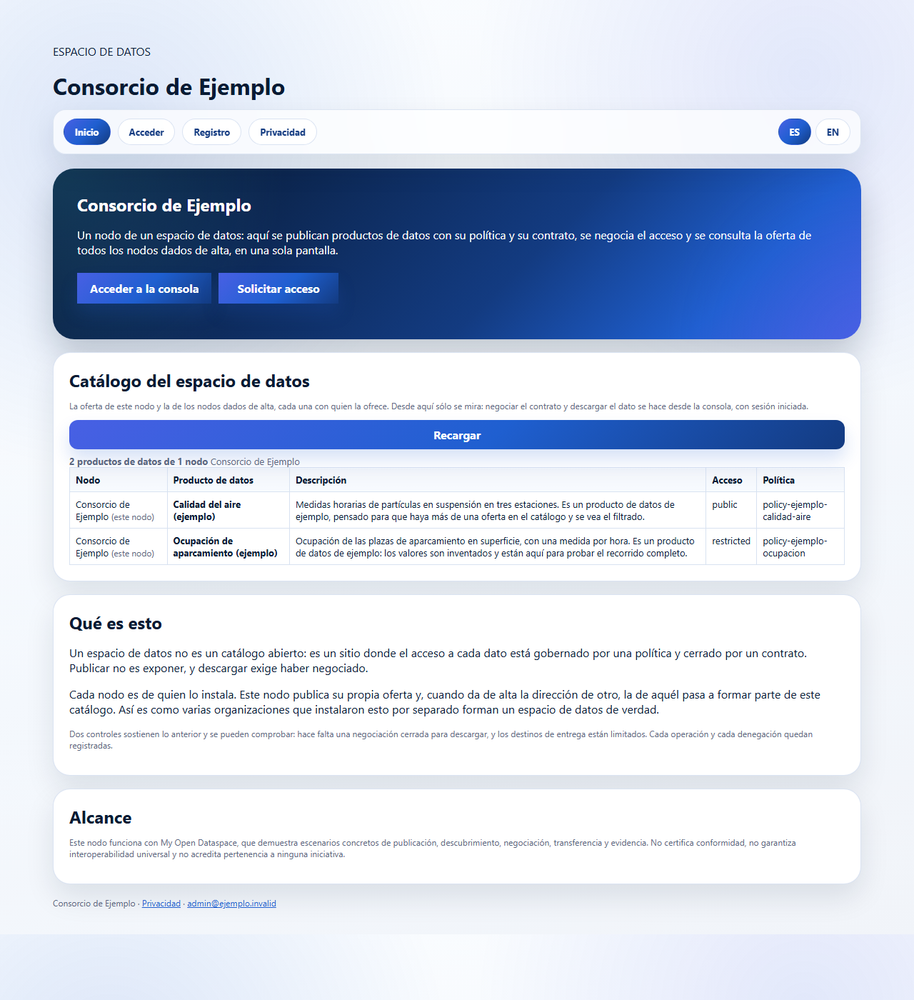
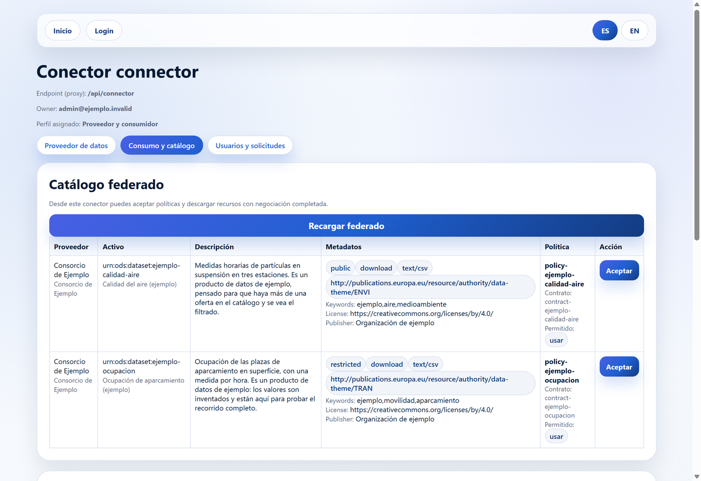

# My Open Dataspace

**English** · [Español](README.es.md)

**Self-hosted dataspace node. Install in five minutes, publish data products
with policies, negotiate contracts and federate your catalogue with other
nodes.**

---

> **Released version: 0.1.0**, with signed images for Intel and ARM. The full
> walkthrough passes green against a real running node.
>
> `main` is ahead: it brings **one connector per participant**, the split
> between publishing and administering the node, and a test that drives a real
> browser through sign-up, login and publishing. Not cut yet —
> [CHANGELOG.md](CHANGELOG.md) lists it.
>
> What is done and what is not, plainly, in
> [docs/en/estado.md](docs/en/estado.md).
>
> The documentation is in English under [docs/en/](docs/en/) and in Spanish
> under [docs/](docs/). The changelog is in Spanish. The node's interface is
> available in Spanish and English.



## What it solves

Setting up a data space today means choosing a connector, an identity
provider, a catalogue, a store and a way for all of them to talk to each
other — and repeating that in every organisation that wants to take part.
This project delivers that combination already solved — six containers, plus
a connector for each participant who signs up — so that an organisation can
install it, give it its email address, its brand and its use cases, and start
publishing and negotiating data the same day.

And so that it is a data space and not an isolated catalogue, each node can
register the address of other nodes: their offers are merged into a single
screen from which you negotiate and download exactly as you would with a
product of your own.

## Three ways in

### Try it — one minute

```bash
docker run -p 8080:8080 -v ods-datos:/var/lib/ods   ghcr.io/nekosphera/my-open-dataspace:0.1.0
```

The `-v` matters: without it, Docker uses an anonymous volume and
**everything you configure is lost when the container is removed** — you are
back at the setup wizard. The image warns about this on startup, because from
inside a container there is no way to tell whether its volume has a name.

Portal, connector, database and RDF store in one container. For evaluation
and teaching: **no TLS, no identity and no authentication**, so anyone who
can reach the port can publish, negotiate and download. It says so on startup
with a banner that fills half the screen.

It cannot be left like that by accident: evaluation mode switches itself off
if it detects a configured identity provider or domain.

### Install it — five minutes

```bash
git clone https://github.com/nekosphera/my-open-dataspace
cd my-open-dataspace
./install.sh
```

The installer asks four things — organisation name, administrator email,
domain (optional) and language —, generates any missing service passwords,
starts the stack and waits until it answers. Then you open `/setup` and answer
four more questions: that is where you choose your administrator password,
which nobody generates for you.

Running it twice breaks nothing: an existing `.env` is never overwritten.

From zero to a published data product to try the full walkthrough with:
**under a minute** once the images are downloaded.

### Run it

`docker compose` with your own `.env` — which is not versioned: it holds the
node's passwords. Upgrading means changing the tag and starting it again:

```bash
ODS_IMAGE_APP="ghcr.io/nekosphera/app:0.1.0"
ODS_IMAGE_CONNECTOR="ghcr.io/nekosphera/connector:0.1.0"
```

The images are signed and ship with their software bill of materials; how to
verify them is in [docs/en/publicar.md](docs/en/publicar.md).

Backups: `./deploy/backup.sh`, and
[docs/en/backup.md](docs/en/backup.md) explains what is saved, what does not
need saving and how to check that a backup works **before** you need it.

Locked out of your node? `./reiniciar.sh --contrasena <email>` — in
PowerShell, `.\reiniciar.ps1` —, and if that is not enough,
[docs/en/recuperar.md](docs/en/recuperar.md) has the other two ways out.

**Where the data lives.** The connector only fetches data from the domains in
`ODS_DOWNLOAD_ALLOWED_HOSTS`, which ships with `localhost`. If you publish a
product whose file lives at another organisation, add its domain there or
nobody will be able to download it. The node tells you **when you publish**,
not when someone tries to download:

```
Este nodo no puede ir a buscar datos a «ejemplo.org», así que publicarlo
dejaría una oferta que nadie puede descargar. Añade «ejemplo.org» a
ODS_DOWNLOAD_ALLOWED_HOSTS en el .env y reinicia el conector.
```

(*"This node cannot fetch data from «ejemplo.org», so publishing it would
leave an offer nobody can download. Add «ejemplo.org» to
ODS_DOWNLOAD_ALLOWED_HOSTS in the .env and restart the connector."*)

**What leaves your node.** The catalogue other nodes read —
`GET /api/v1/catalog`, public and read-only — carries the offer and **the
`ODS_ADMIN_EMAIL` address** as the participant's contact point, as DCAT-AP
requires. No other address leaves: each offer is attributed to its
connector's identifier, never to the email of whoever published it. If you do
not want a personal address in other nodes' catalogues, use a role address.

## One connector per participant

Anyone can request to join a node from its sign-up page, saying whether they
want to act as a **consumer**, a **provider** or both. The node administrator
approves the request from the console and, on approval, a connector of their
own is deployed for them with that profile.

Their own means their own: it has its own identifier, credentials, offer and
console. The assets, policies and contracts they publish belong to their
connector, not to the node — under "View my assets" they see theirs and
nothing else —, and in the data space catalogue they appear attributed to it.
Another participant on the same node sees that offer as a third party's:
they accept its policy, negotiate the contract and download the data, just as
if it were in another organisation.

Who can do what is decided by their profile and enforced by the connector:
publishing requires `dataspace-provider`, negotiating `dataspace-negotiator`,
and approving sign-ups belongs to `dataspace-admins` and nobody else. The
connector's identity travels signed in the token; it is not inferred from a
name.

> **The cost, plainly.** Starting one container per participant requires the
> Docker socket mounted into `app`, and **that is root-equivalent access to
> the host machine**: whoever reaches that process can ask the daemon for a
> privileged container or for the host's disk mounted. The mount's `:ro` only
> prevents rewriting the socket file; it limits nothing that is done through
> it.
>
> If you do not want that exposure, remove that line from
> `docker-compose.yml`. Sign-ups are then left without a connector of their
> own, and the node says so on approval instead of failing silently.

## The console

This is where the work happens: you publish a data product with its policy and
contract, see the merged offer of every registered node, accept a policy and
download the data. The node administrator also has the sign-ups tab, to
approve whoever asks to join.



Downloading requires a completed negotiation, and the connector binds it to
the person who made it: an attempt without one is rejected and logged.

When someone creates a contract, its offer **takes a few seconds** to appear
in the federated catalogue. The node federates as soon as it sees the
contract, without waiting for the sync interval, but it has to ask every
connector and write the difference to the RDF store. The console reloads on
its own: if it does not appear straight away, do not create the contract
again — wait or press **Reload federated**.

## What is inside

| Container | Purpose |
|---|---|
| `caddy` | Entry point and automatic TLS. A single exposed port. |
| `app` | Public portal, participant console and sign-up API. |
| `connector` | The node's connector — the project's own, with an EDC-style management API: assets, policies, contracts, negotiation and mediated download. |
| `postgres` | Database for the application, the node's connector and each participant's connector. |
| `keycloak` | OIDC identity and roles, with the realm imported on startup. |
| `fuseki` | RDF store behind the merged federated catalogue. |
| `ods-connector-…` | One per participant. The node starts it when their sign-up is approved, with its own database, and removes it when they are removed. |

## Customising it

This is why the project exists. Full guide in
[docs/en/personalizacion.md](docs/en/personalizacion.md), including the list of
what **cannot** be customised without touching code, stated there so that
nobody finds out halfway through a migration.

- **Brand** — name, logo, colour and legal notice from `.env` and the wizard.
- **Profiles** — `profiles/` ships generic `dcat-ap` and `odrl` profiles.
  Adding your own is copying a folder; no code changes needed.
- **Use cases** — `seed/` holds the sample data, meant to be replaced with
  your own.
- **Federation with other nodes** — another node's offer becomes part of your
  merged catalogue. The only thing a node exposes for this is
  `GET /api/v1/catalog`: public, read-only and containing only the offer. The
  connector's management API is never published. The procedure is in
  [docs/en/dos-nodos.md](docs/en/dos-nodos.md).

## Scope

This project demonstrates concrete publication, discovery, negotiation,
transfer and evidence scenarios. **It does not certify conformance, does not
guarantee universal interoperability, and does not accredit membership of
SIMPL, Gaia-X, FIWARE, IDSA or EHDS.**

The connector shipped here is this project's own, not an official Eclipse
Dataspace Components distribution, and it has not been run against the
Dataspace Protocol test suite.

The full text is in [docs/en/alcance.md](docs/en/alcance.md). Its canonical
copy, the one pasted into each release's notes, is
[docs/alcance.md](docs/alcance.md).

## Documentation

In English; the Spanish originals are in [docs/](docs/).

| | |
|---|---|
| [Customising your node](docs/en/personalizacion.md) | Brand, profiles, use cases, and what cannot be customised |
| [Running two nodes](docs/en/dos-nodos.md) | See federation working, and check that a node going down does not break the view |
| [Backups](docs/en/backup.md) | What to save, how to restore and how to check it |
| [Locked out of my node](docs/en/recuperar.md) | Password, reopening the wizard, or starting from scratch |
| [Cutting a release](docs/en/publicar.md) | How it is cut, which images come out and how to verify them |
| [Scope](docs/en/alcance.md) | What this project does not claim |
| [Status](docs/en/estado.md) | What is done and what is not |
| [Decisions](docs/en/decisiones.md) | What the specification did not cover, and why it was resolved that way |
| [Provenance](docs/en/procedencia.md) | Which repository and commit each block comes from |
| [Changes](CHANGELOG.md) | What has changed, and why |

## Licence

[Apache-2.0](LICENSE). Third-party attributions are in [NOTICE](NOTICE).
